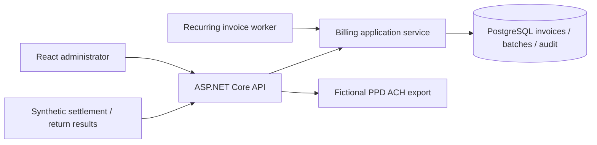

# Enterprise Billing Platform

An original, fictional reference implementation by Eric Wright. Demonstrates financial transaction processing and business-critical operational controls; it is **not** a Merchant First or Pinot’s Palette project and contains no employer code or customer data.

## Five-minute demo

Prerequisites: Docker Compose, or .NET 10 + Node 22 + PostgreSQL 17; Python 3 for the smoke test.

```sh
cp .env.example .env
# Choose a local password in .env (never commit it).
docker compose up --build -d
python3 scripts/demo.py
# Open http://localhost:5080 for the React administrative interface.
```

The script seeds two fictional customers, generates November invoices totaling $378, creates the same batch on retry, downloads an ACH file, settles one payment, returns the other with R01, and asserts that the report balances. Repeating it is safe. The UI offers the same workflow. ACH output is under ignored `artifacts/`.

## Business problem and implemented capabilities

Recurring billing needs reproducible collections and a reliable explanation for every financial state change. This slice implements monthly subscriptions, stable invoice/payment identities, a transactionally created batch, NACHA-formatted debit export with control validation, terminal reconciliation, an append-only application audit stream, and cents-based reporting. A background worker generates current-month invoices when `Billing__RecurringEnabled=true`; it never automatically sends money.



## Local development and tests

```sh
# PostgreSQL must be running; use a dedicated test database!
export ConnectionStrings__Billing='Host=127.0.0.1;Database=billing;Username=billing;Password=YOUR_LOCAL_PASSWORD'
export BILLING_TEST_DB='Host=127.0.0.1;Database=billing_test;Username=billing;Password=YOUR_LOCAL_PASSWORD'
dotnet test tests/Billing.Tests
# DatabaseTests deletes/recreates ONLY the database named in BILLING_TEST_DB.
dotnet run --project src/Billing.Api --urls http://127.0.0.1:5080
# Separate terminal:
cd web && npm ci && npm run dev
# Production UI output, served by API:
npm run build
```

CI runs xUnit against disposable PostgreSQL and compiles the UI. Tests cover deterministic ACH output, corrupted totals, invalid periods/results, and PostgreSQL invoice/batch/result idempotency. `scripts/demo.py` exercises the HTTP boundary. API routes are discoverable in `Program.cs`; `/health` checks database connectivity, `/api/audit` exposes audit events, `/api/reports` exposes aggregate cents.

## Decisions and tradeoffs

See [ADR 001](docs/adr/001-financial-consistency.md). Integer cents avoid floating-point errors. Unique constraints plus a PostgreSQL advisory transaction lock serialize mutations across API and worker processes. A batch freezes a period and effective date; date changes after creation return conflict. This favors demonstrable correctness over throughput. Reconciliation accepts explicit structured synthetic results rather than pretending every bank uses the same return-file format.

## ACH assumptions and limitations

See [NACHA assumptions](docs/nacha.md). **Not certified for live ACH processing. Bank-specific validation, compliance, security review, authorization and operational controls are required before any real use.** No live banking integration exists. All accounts/names are fictional. Do not submit generated files to a bank.

This is a loopback-only development demo with no authentication. Never expose it publicly. PostgreSQL credentials are local configuration, not production secrets. `EnsureCreated` bootstraps new databases; versioned migrations, authentication/RBAC, tamper-evident audit storage, encrypted banking data, holiday calendars, payment authorization, retries of returned payments, multi-currency and bank transport are future work. Audit rows are append-only through this application, not protected against database administrators. A returned invoice is terminal in this slice; retries require a future explicit attempt model. Docker tags track supported releases rather than immutable digests.
